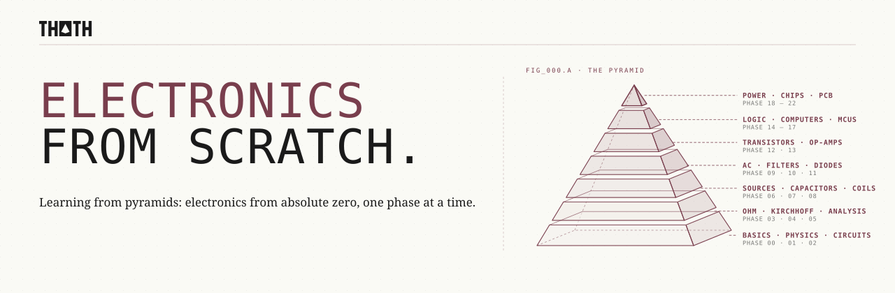

<p align="center">
  <picture>
    <source media="(prefers-color-scheme: dark)" srcset="assets/readme/header-dark.svg">
    
  </picture>
</p>

Learn electronics from absolute zero. Start with what a volt and an ampere really are, work up through resistors, capacitors, diodes, transistors and op-amps, build a computer out of logic gates, design the arithmetic inside an AI chip, and finish by designing a real printed circuit board. Every idea is simulated with a circuit simulator you build yourself, and almost every phase has hands-on tasks in the interactive lab.

> 170 lessons. 23 phases. 110 lab tasks. Python and NumPy, no prior knowledge.

<p align="center">
  <a href="LICENSE"></a>
  <a href="#contents"></a>
  <a href="#contents"></a>
  <a href="#the-lab"></a>
</p>

## Phases

| # | Phase | Lessons | What it is about |
|---|---|---|---|
| 00 | [Words and Units](phases/00-words-and-units/) | 6 | Before you can understand a circuit, you have to be able to read the sentence that describes it. |
| 01 | [The Physics Underneath](phases/01-the-physics-underneath/) | 7 | Every rule in electronics is a shortcut for something electrons are physically doing. |
| 02 | [Your First Circuits](phases/02-your-first-circuits/) | 7 | Electricity only does work when it has a complete path to travel and a way back home. |
| 03 | [Resistance and Ohm's Law](phases/03-resistance-and-ohms-law/) | 7 | Resistance is how hard a material makes charge work to get through. Once you can put a number on it, you can predict the current, the heat and the failure of every simple circuit. |
| 04 | [Kirchhoff's Laws](phases/04-kirchhoffs-laws/) | 7 | Charge is never lost at a junction and energy is never lost around a loop. Two bookkeeping rules, and every resistor circuit gives up its secrets. |
| 05 | [Circuit Analysis and Our Simulator](phases/05-circuit-analysis-and-our-simulator/) | 8 | Stop solving circuits by cleverness. Write down the equations the same way every time, and let a machine do the arithmetic. |
| 06 | [Sources, Batteries and Measurement](phases/06-sources-batteries-and-measurement/) | 7 | Nothing is ideal: every source sags, every meter disturbs. Knowing by how much is what makes a measurement worth trusting. |
| 07 | [Capacitors](phases/07-capacitors/) | 8 | The first part with memory: a capacitor's voltage today depends on every bit of current it received before. |
| 08 | [Magnetism and Inductors](phases/08-magnetism-and-inductors/) | 7 | Moving charge makes magnetism, and changing magnetism moves charge. Coils, transformers and motors are those two sentences built in copper. |
| 09 | [Alternating Current](phases/09-alternating-current/) | 7 | The wall socket pushes back and forth fifty times a second. Learn to describe that push with one complex number, and AC circuits become as easy as DC ones. |
| 10 | [Filters and Resonance](phases/10-filters-and-resonance/) | 8 | Every signal is a chord of sine waves. Filters choose which notes to keep, and resonance lets an inductor and a capacitor pick a single note out of thousands. |
| 11 | [Semiconductors and Diodes](phases/11-semiconductors-and-diodes/) | 8 | Everything so far obeyed straight lines. A pinch of the right impurity in silicon gives you a one-way street for current, and from then on electronics is exponential. |
| 12 | [Transistors](phases/12-transistors/) | 8 | A small signal on one terminal decides how much current flows between the other two. Use it fully on or off and you have a switch; use it half on and you have an amplifier. |
| 13 | [Operational Amplifiers](phases/13-operational-amplifiers/) | 7 | An op-amp is an amplifier with an absurd gain and two inputs. Wrap it in negative feedback and it does exactly what two resistors tell it to. |
| 14 | [Digital Logic](phases/14-digital-logic/) | 8 | Two voltage levels, three Boolean operations and a handful of gates: enough to build anything that computes. |
| 15 | [Sequential Logic](phases/15-sequential-logic/) | 7 | Feed a gate's output back to its input and it starts to remember; add a clock and millions of those memories move in step. |
| 16 | [A Computer from Gates](phases/16-a-computer-from-gates/) | 7 | A computer is an adder, a few registers, a memory and a small state machine, arranged so that numbers in memory decide what the machine does next. |
| 17 | [Microcontrollers](phases/17-microcontrollers/) | 7 | A microcontroller is the computer you built in Phase 16, shrunk onto one chip and given legs: it reads the world through some pins and pushes on it through others. |
| 18 | [Power Electronics](phases/18-power-electronics/) | 7 | Every circuit runs on power that someone had to convert, and every conversion either wastes energy as heat or uses switches clever enough not to. |
| 19 | [Sensors and Signals](phases/19-sensors-and-signals/) | 7 | A measurement is a chain from the physical world to a number, and every link either keeps the information or loses some of it. Learn where it leaks, and you can make a cheap sensor give an excellent reading. |
| 20 | [Chip Design](phases/20-chip-design/) | 11 | Designing a chip is spending a budget of area, energy and time between computing and moving data. |
| 21 | [PCB Design and Manufacturing](phases/21-pcb-design-and-manufacturing/) | 7 | A schematic says what is connected. A board says where, and "where" turns out to matter. |
| 22 | [Capstone](phases/22-capstone/) | 7 | Specify it, simulate it, lay it out, bring it up: one small device, everything you have learned. |

## Every lesson has the same shape

```
NN-lesson-name/
├── code/main.py   from-scratch implementation, runnable from the repo root
├── docs/en.md     Words You'll Meet · The Physics · The Concept · Build It · Use It · Exercises
├── quiz.json      questions to check yourself before and after
└── lab/task.json  a hands-on task for the interactive lab (most lessons from Phase 02 on)
```

## Our own simulator

`sim/` is a small circuit simulator written for this course in plain Python and NumPy. It does DC operating points, transient (time) simulation and AC frequency sweeps, plus gate-level logic and a cost model for chip design. Phase 05 builds its core, modified nodal analysis, from scratch; Phases 07 and 10 build transient and AC analysis by hand and compare them with `sim`.

```python
from sim import Circuit

c = Circuit()
c.voltage_source("V1", "vcc", "0", 9.0)
c.resistor("R1", "vcc", "a", 680)
c.led("D1", "a", "0", color="red")
print(c.dc().i("D1"))
```

<a id="the-lab"></a>

## The lab

`lab/` is a static web page: every task is a small circuit with empty slots. Drop a part in each slot, press RUN, and the simulator checks the goals. Nothing to install:

```bash
uv run python scripts/build_lab.py
cd lab && python -m http.server 8000
```

Then open http://localhost:8000. `uv run python -m sim.lab phases/03-resistance-and-ohms-law/03-ohms-law/lab/task.json` checks a task from the terminal.

## Local setup

```bash
git clone https://github.com/Fer14/electronics-from-scratch.git
cd electronics-from-scratch
uv sync
uv run python phases/00-words-and-units/01-what-electronics-is/code/main.py
```

No uv? `python -m venv .venv && source .venv/bin/activate && pip install -r requirements.txt` works too.

Check that every lesson runs: `uv run python scripts/check.py`

<a id="contents"></a>

## Contents

<a id="phase-00"></a>
<details>
<summary><strong>Phase 00 · Words and Units</strong> · 6 lessons</summary>

> Before you can understand a circuit, you have to be able to read the sentence that describes it.

| # | Lesson |
|---|---|
| 01 | [What Electronics Is](phases/00-words-and-units/01-what-electronics-is/) |
| 02 | [The Vocabulary](phases/00-words-and-units/02-the-vocabulary/) |
| 03 | [Units and SI Prefixes](phases/00-words-and-units/03-units-and-si-prefixes/) |
| 04 | [Scientific Notation and Orders of Magnitude](phases/00-words-and-units/04-scientific-notation-and-orders-of-magnitude/) |
| 05 | [Reading a Schematic](phases/00-words-and-units/05-reading-a-schematic/) |
| 06 | [Safety First](phases/00-words-and-units/06-safety-first/) |

</details>

<a id="phase-01"></a>
<details>
<summary><strong>Phase 01 · The Physics Underneath</strong> · 7 lessons</summary>

> Every rule in electronics is a shortcut for something electrons are physically doing.

| # | Lesson |
|---|---|
| 01 | [Atoms and Electrons](phases/01-the-physics-underneath/01-atoms-and-electrons/) |
| 02 | [Electric Charge and Coulomb's Law](phases/01-the-physics-underneath/02-electric-charge-and-coulombs-law/) |
| 03 | [The Electric Field](phases/01-the-physics-underneath/03-the-electric-field/) |
| 04 | [Energy, Potential and Voltage](phases/01-the-physics-underneath/04-energy-potential-and-voltage/) |
| 05 | [Conductors, Insulators and Semiconductors](phases/01-the-physics-underneath/05-conductors-insulators-and-semiconductors/) |
| 06 | [Current as Moving Charge](phases/01-the-physics-underneath/06-current-as-moving-charge/) |
| 07 | [Energy and Power](phases/01-the-physics-underneath/07-energy-and-power/) |

</details>

<a id="phase-02"></a>
<details>
<summary><strong>Phase 02 · Your First Circuits</strong> · 7 lessons</summary>

> Electricity only does work when it has a complete path to travel and a way back home.

| # | Lesson |
|---|---|
| 01 | [The Closed Loop](phases/02-your-first-circuits/01-the-closed-loop/) |
| 02 | [Batteries and Loads](phases/02-your-first-circuits/02-batteries-and-loads/) |
| 03 | [Switches, Open and Short Circuits](phases/02-your-first-circuits/03-switches-open-and-short-circuits/) |
| 04 | [Series and Parallel Intuition](phases/02-your-first-circuits/04-series-and-parallel-intuition/) |
| 05 | [The Water Analogy and Its Limits](phases/02-your-first-circuits/05-the-water-analogy-and-its-limits/) |
| 06 | [The Breadboard](phases/02-your-first-circuits/06-the-breadboard/) |
| 07 | [Measuring with a Multimeter](phases/02-your-first-circuits/07-measuring-with-a-multimeter/) |

</details>

<a id="phase-03"></a>
<details>
<summary><strong>Phase 03 · Resistance and Ohm's Law</strong> · 7 lessons</summary>

> Resistance is how hard a material makes charge work to get through. Once you can put a number on it, you can predict the current, the heat and the failure of every simple circuit.

| # | Lesson |
|---|---|
| 01 | [What Resistance Is](phases/03-resistance-and-ohms-law/01-what-resistance-is/) |
| 02 | [Resistivity and Wires](phases/03-resistance-and-ohms-law/02-resistivity-and-wires/) |
| 03 | [Ohm's Law](phases/03-resistance-and-ohms-law/03-ohms-law/) |
| 04 | [Resistors and Color Codes](phases/03-resistance-and-ohms-law/04-resistors-and-color-codes/) |
| 05 | [Power and Heat](phases/03-resistance-and-ohms-law/05-power-and-heat/) |
| 06 | [Tolerances and Ratings](phases/03-resistance-and-ohms-law/06-tolerances-and-ratings/) |
| 07 | [When Ohm's Law Fails](phases/03-resistance-and-ohms-law/07-when-ohms-law-fails/) |

</details>

<a id="phase-04"></a>
<details>
<summary><strong>Phase 04 · Kirchhoff's Laws</strong> · 7 lessons</summary>

> Charge is never lost at a junction and energy is never lost around a loop. Two bookkeeping rules, and every resistor circuit gives up its secrets.

| # | Lesson |
|---|---|
| 01 | [Nodes, Branches and Loops](phases/04-kirchhoffs-laws/01-nodes-branches-and-loops/) |
| 02 | [Kirchhoff's Current Law](phases/04-kirchhoffs-laws/02-kirchhoffs-current-law/) |
| 03 | [Kirchhoff's Voltage Law](phases/04-kirchhoffs-laws/03-kirchhoffs-voltage-law/) |
| 04 | [Series and Parallel Resistors](phases/04-kirchhoffs-laws/04-series-and-parallel-resistors/) |
| 05 | [The Voltage Divider](phases/04-kirchhoffs-laws/05-the-voltage-divider/) |
| 06 | [The Current Divider](phases/04-kirchhoffs-laws/06-the-current-divider/) |
| 07 | [The Wheatstone Bridge](phases/04-kirchhoffs-laws/07-the-wheatstone-bridge/) |

</details>

<a id="phase-05"></a>
<details>
<summary><strong>Phase 05 · Circuit Analysis and Our Simulator</strong> · 8 lessons</summary>

> Stop solving circuits by cleverness. Write down the equations the same way every time, and let a machine do the arithmetic.

| # | Lesson |
|---|---|
| 01 | [Systematic Analysis](phases/05-circuit-analysis-and-our-simulator/01-systematic-analysis/) |
| 02 | [Nodal Analysis](phases/05-circuit-analysis-and-our-simulator/02-nodal-analysis/) |
| 03 | [Mesh Analysis](phases/05-circuit-analysis-and-our-simulator/03-mesh-analysis/) |
| 04 | [Modified Nodal Analysis from Scratch](phases/05-circuit-analysis-and-our-simulator/04-modified-nodal-analysis-from-scratch/) |
| 05 | [Superposition](phases/05-circuit-analysis-and-our-simulator/05-superposition/) |
| 06 | [Thevenin and Norton](phases/05-circuit-analysis-and-our-simulator/06-thevenin-and-norton/) |
| 07 | [Maximum Power Transfer](phases/05-circuit-analysis-and-our-simulator/07-maximum-power-transfer/) |
| 08 | [Dependent Sources](phases/05-circuit-analysis-and-our-simulator/08-dependent-sources/) |

</details>

<a id="phase-06"></a>
<details>
<summary><strong>Phase 06 · Sources, Batteries and Measurement</strong> · 7 lessons</summary>

> Nothing is ideal: every source sags, every meter disturbs. Knowing by how much is what makes a measurement worth trusting.

| # | Lesson |
|---|---|
| 01 | [Ideal and Real Sources](phases/06-sources-batteries-and-measurement/01-ideal-and-real-sources/) |
| 02 | [Internal Resistance](phases/06-sources-batteries-and-measurement/02-internal-resistance/) |
| 03 | [How Batteries Work](phases/06-sources-batteries-and-measurement/03-how-batteries-work/) |
| 04 | [Inside the Multimeter](phases/06-sources-batteries-and-measurement/04-inside-the-multimeter/) |
| 05 | [Loading and Measurement Error](phases/06-sources-batteries-and-measurement/05-loading-and-measurement-error/) |
| 06 | [The Oscilloscope](phases/06-sources-batteries-and-measurement/06-the-oscilloscope/) |
| 07 | [Lab Power Supplies](phases/06-sources-batteries-and-measurement/07-lab-power-supplies/) |

</details>

<a id="phase-07"></a>
<details>
<summary><strong>Phase 07 · Capacitors</strong> · 8 lessons</summary>

> The first part with memory: a capacitor's voltage today depends on every bit of current it received before.

| # | Lesson |
|---|---|
| 01 | [Storing Charge](phases/07-capacitors/01-storing-charge/) |
| 02 | [Capacitance](phases/07-capacitors/02-capacitance/) |
| 03 | [Charging and Discharging](phases/07-capacitors/03-charging-and-discharging/) |
| 04 | [The Time Constant](phases/07-capacitors/04-the-time-constant/) |
| 05 | [Capacitors in Series and Parallel](phases/07-capacitors/05-capacitors-in-series-and-parallel/) |
| 06 | [Energy in the Electric Field](phases/07-capacitors/06-energy-in-the-electric-field/) |
| 07 | [Real Capacitors](phases/07-capacitors/07-real-capacitors/) |
| 08 | [Transient Simulation from Scratch](phases/07-capacitors/08-transient-simulation-from-scratch/) |

</details>

<a id="phase-08"></a>
<details>
<summary><strong>Phase 08 · Magnetism and Inductors</strong> · 7 lessons</summary>

> Moving charge makes magnetism, and changing magnetism moves charge. Coils, transformers and motors are those two sentences built in copper.

| # | Lesson |
|---|---|
| 01 | [Magnets and Magnetic Fields](phases/08-magnetism-and-inductors/01-magnets-and-magnetic-fields/) |
| 02 | [Electromagnetism](phases/08-magnetism-and-inductors/02-electromagnetism/) |
| 03 | [Faraday's Law and Induction](phases/08-magnetism-and-inductors/03-faradays-law-and-induction/) |
| 04 | [The Inductor](phases/08-magnetism-and-inductors/04-the-inductor/) |
| 05 | [RL Transients](phases/08-magnetism-and-inductors/05-rl-transients/) |
| 06 | [Transformers](phases/08-magnetism-and-inductors/06-transformers/) |
| 07 | [Motors and Generators](phases/08-magnetism-and-inductors/07-motors-and-generators/) |

</details>

<a id="phase-09"></a>
<details>
<summary><strong>Phase 09 · Alternating Current</strong> · 7 lessons</summary>

> The wall socket pushes back and forth fifty times a second. Learn to describe that push with one complex number, and AC circuits become as easy as DC ones.

| # | Lesson |
|---|---|
| 01 | [Why Alternating Current](phases/09-alternating-current/01-why-alternating-current/) |
| 02 | [Sine Waves, Frequency and Phase](phases/09-alternating-current/02-sine-waves-frequency-and-phase/) |
| 03 | [RMS Values](phases/09-alternating-current/03-rms-values/) |
| 04 | [Complex Numbers for Circuits](phases/09-alternating-current/04-complex-numbers-for-circuits/) |
| 05 | [Phasors](phases/09-alternating-current/05-phasors/) |
| 06 | [Impedance](phases/09-alternating-current/06-impedance/) |
| 07 | [AC Power and Power Factor](phases/09-alternating-current/07-ac-power-and-power-factor/) |

</details>

<a id="phase-10"></a>
<details>
<summary><strong>Phase 10 · Filters and Resonance</strong> · 8 lessons</summary>

> Every signal is a chord of sine waves. Filters choose which notes to keep, and resonance lets an inductor and a capacitor pick a single note out of thousands.

| # | Lesson |
|---|---|
| 01 | [What a Filter Does](phases/10-filters-and-resonance/01-what-a-filter-does/) |
| 02 | [RC Low-Pass and High-Pass](phases/10-filters-and-resonance/02-rc-low-pass-and-high-pass/) |
| 03 | [Decibels and Bode Plots](phases/10-filters-and-resonance/03-decibels-and-bode-plots/) |
| 04 | [RL Filters](phases/10-filters-and-resonance/04-rl-filters/) |
| 05 | [RLC Resonance](phases/10-filters-and-resonance/05-rlc-resonance/) |
| 06 | [Band-Pass and Band-Stop](phases/10-filters-and-resonance/06-band-pass-and-band-stop/) |
| 07 | [Quality Factor](phases/10-filters-and-resonance/07-quality-factor/) |
| 08 | [AC Analysis in Our Simulator](phases/10-filters-and-resonance/08-ac-analysis-in-our-simulator/) |

</details>

<a id="phase-11"></a>
<details>
<summary><strong>Phase 11 · Semiconductors and Diodes</strong> · 8 lessons</summary>

> Everything so far obeyed straight lines. A pinch of the right impurity in silicon gives you a one-way street for current, and from then on electronics is exponential.

| # | Lesson |
|---|---|
| 01 | [Why Silicon](phases/11-semiconductors-and-diodes/01-why-silicon/) |
| 02 | [Doping: n-type and p-type](phases/11-semiconductors-and-diodes/02-doping-n-and-p/) |
| 03 | [The pn Junction](phases/11-semiconductors-and-diodes/03-the-pn-junction/) |
| 04 | [The Diode Equation](phases/11-semiconductors-and-diodes/04-the-diode-equation/) |
| 05 | [Solving Nonlinear Circuits](phases/11-semiconductors-and-diodes/05-solving-nonlinear-circuits/) |
| 06 | [Rectifiers](phases/11-semiconductors-and-diodes/06-rectifiers/) |
| 07 | [LEDs](phases/11-semiconductors-and-diodes/07-leds/) |
| 08 | [Zener Diodes](phases/11-semiconductors-and-diodes/08-zener-diodes/) |

</details>

<a id="phase-12"></a>
<details>
<summary><strong>Phase 12 · Transistors</strong> · 8 lessons</summary>

> A small signal on one terminal decides how much current flows between the other two. Use it fully on or off and you have a switch; use it half on and you have an amplifier.

| # | Lesson |
|---|---|
| 01 | [The Transistor Idea](phases/12-transistors/01-the-transistor-idea/) |
| 02 | [The BJT](phases/12-transistors/02-the-bjt/) |
| 03 | [The BJT as a Switch](phases/12-transistors/03-the-bjt-as-a-switch/) |
| 04 | [The MOSFET](phases/12-transistors/04-the-mosfet/) |
| 05 | [The MOSFET as a Switch](phases/12-transistors/05-the-mosfet-as-a-switch/) |
| 06 | [Amplifiers and Biasing](phases/12-transistors/06-amplifiers-and-biasing/) |
| 07 | [Small-Signal Thinking](phases/12-transistors/07-small-signal-thinking/) |
| 08 | [Current Mirrors](phases/12-transistors/08-current-mirrors/) |

</details>

<a id="phase-13"></a>
<details>
<summary><strong>Phase 13 · Operational Amplifiers</strong> · 7 lessons</summary>

> An op-amp is an amplifier with an absurd gain and two inputs. Wrap it in negative feedback and it does exactly what two resistors tell it to.

| # | Lesson |
|---|---|
| 01 | [The Ideal Op-Amp](phases/13-operational-amplifiers/01-the-ideal-op-amp/) |
| 02 | [The Comparator](phases/13-operational-amplifiers/02-the-comparator/) |
| 03 | [Inverting and Non-Inverting Amplifiers](phases/13-operational-amplifiers/03-inverting-and-non-inverting-amplifiers/) |
| 04 | [Summers and Difference Amplifiers](phases/13-operational-amplifiers/04-summers-and-difference-amplifiers/) |
| 05 | [Integrators and Differentiators](phases/13-operational-amplifiers/05-integrators-and-differentiators/) |
| 06 | [Active Filters](phases/13-operational-amplifiers/06-active-filters/) |
| 07 | [Real Op-Amp Limits](phases/13-operational-amplifiers/07-real-op-amp-limits/) |

</details>

<a id="phase-14"></a>
<details>
<summary><strong>Phase 14 · Digital Logic</strong> · 8 lessons</summary>

> Two voltage levels, three Boolean operations and a handful of gates: enough to build anything that computes.

| # | Lesson |
|---|---|
| 01 | [Analog vs Digital](phases/14-digital-logic/01-analog-vs-digital/) |
| 02 | [Binary Numbers](phases/14-digital-logic/02-binary-numbers/) |
| 03 | [Boolean Algebra](phases/14-digital-logic/03-boolean-algebra/) |
| 04 | [Logic Gates](phases/14-digital-logic/04-logic-gates/) |
| 05 | [CMOS Gates from Transistors](phases/14-digital-logic/05-cmos-gates-from-transistors/) |
| 06 | [Combinational Circuits](phases/14-digital-logic/06-combinational-circuits/) |
| 07 | [Adders](phases/14-digital-logic/07-adders/) |
| 08 | [Multiplexers and Decoders](phases/14-digital-logic/08-multiplexers-and-decoders/) |

</details>

<a id="phase-15"></a>
<details>
<summary><strong>Phase 15 · Sequential Logic</strong> · 7 lessons</summary>

> Feed a gate's output back to its input and it starts to remember; add a clock and millions of those memories move in step.

| # | Lesson |
|---|---|
| 01 | [Memory from Feedback](phases/15-sequential-logic/01-memory-from-feedback/) |
| 02 | [Latches](phases/15-sequential-logic/02-latches/) |
| 03 | [Flip-Flops and the Clock](phases/15-sequential-logic/03-flip-flops-and-the-clock/) |
| 04 | [Registers](phases/15-sequential-logic/04-registers/) |
| 05 | [Counters](phases/15-sequential-logic/05-counters/) |
| 06 | [Finite State Machines](phases/15-sequential-logic/06-finite-state-machines/) |
| 07 | [Timing and Metastability](phases/15-sequential-logic/07-timing-and-metastability/) |

</details>

<a id="phase-16"></a>
<details>
<summary><strong>Phase 16 · A Computer from Gates</strong> · 7 lessons</summary>

> A computer is an adder, a few registers, a memory and a small state machine, arranged so that numbers in memory decide what the machine does next.

| # | Lesson |
|---|---|
| 01 | [What a Computer Is](phases/16-a-computer-from-gates/01-what-a-computer-is/) |
| 02 | [The ALU](phases/16-a-computer-from-gates/02-the-alu/) |
| 03 | [Memory](phases/16-a-computer-from-gates/03-memory/) |
| 04 | [The Datapath](phases/16-a-computer-from-gates/04-the-datapath/) |
| 05 | [The Control Unit](phases/16-a-computer-from-gates/05-the-control-unit/) |
| 06 | [Instructions and Assembly](phases/16-a-computer-from-gates/06-instructions-and-assembly/) |
| 07 | [Running a Program](phases/16-a-computer-from-gates/07-running-a-program/) |

</details>

<a id="phase-17"></a>
<details>
<summary><strong>Phase 17 · Microcontrollers</strong> · 7 lessons</summary>

> A microcontroller is the computer you built in Phase 16, shrunk onto one chip and given legs: it reads the world through some pins and pushes on it through others.

| # | Lesson |
|---|---|
| 01 | [What a Microcontroller Is](phases/17-microcontrollers/01-what-a-microcontroller-is/) |
| 02 | [GPIO](phases/17-microcontrollers/02-gpio/) |
| 03 | [PWM](phases/17-microcontrollers/03-pwm/) |
| 04 | [ADC and DAC](phases/17-microcontrollers/04-adc-and-dac/) |
| 05 | [Timers and Interrupts](phases/17-microcontrollers/05-timers-and-interrupts/) |
| 06 | [UART, I2C and SPI](phases/17-microcontrollers/06-uart-i2c-and-spi/) |
| 07 | [A Virtual Microcontroller](phases/17-microcontrollers/07-a-virtual-microcontroller/) |

</details>

<a id="phase-18"></a>
<details>
<summary><strong>Phase 18 · Power Electronics</strong> · 7 lessons</summary>

> Every circuit runs on power that someone had to convert, and every conversion either wastes energy as heat or uses switches clever enough not to.

| # | Lesson |
|---|---|
| 01 | [Linear Regulators](phases/18-power-electronics/01-linear-regulators/) |
| 02 | [Switching Converters](phases/18-power-electronics/02-switching-converters/) |
| 03 | [The Buck Converter](phases/18-power-electronics/03-the-buck-converter/) |
| 04 | [The Boost Converter](phases/18-power-electronics/04-the-boost-converter/) |
| 05 | [Motors and the H-Bridge](phases/18-power-electronics/05-motors-and-the-h-bridge/) |
| 06 | [Batteries and Charging](phases/18-power-electronics/06-batteries-and-charging/) |
| 07 | [Heat and Thermal Design](phases/18-power-electronics/07-heat-and-thermal-design/) |

</details>

<a id="phase-19"></a>
<details>
<summary><strong>Phase 19 · Sensors and Signals</strong> · 7 lessons</summary>

> A measurement is a chain from the physical world to a number, and every link either keeps the information or loses some of it. Learn where it leaks, and you can make a cheap sensor give an excellent reading.

| # | Lesson |
|---|---|
| 01 | [What a Sensor Is](phases/19-sensors-and-signals/01-what-a-sensor-is/) |
| 02 | [Temperature, Light and Force](phases/19-sensors-and-signals/02-temperature-light-and-force/) |
| 03 | [Signal Conditioning](phases/19-sensors-and-signals/03-signal-conditioning/) |
| 04 | [Sampling and Nyquist](phases/19-sensors-and-signals/04-sampling-and-nyquist/) |
| 05 | [Quantization](phases/19-sensors-and-signals/05-quantization/) |
| 06 | [Noise](phases/19-sensors-and-signals/06-noise/) |
| 07 | [Digital Filtering](phases/19-sensors-and-signals/07-digital-filtering/) |

</details>

<a id="phase-20"></a>
<details>
<summary><strong>Phase 20 · Chip Design</strong> · 11 lessons</summary>

> Designing a chip is spending a budget of area, energy and time between computing and moving data.

| # | Lesson |
|---|---|
| 01 | [From Gates to Adders](phases/20-chip-design/01-from-gates-to-adders/) |
| 02 | [Multiplying in Hardware](phases/20-chip-design/02-multiplying-in-hardware/) |
| 03 | [The MAC](phases/20-chip-design/03-the-mac/) |
| 04 | [Moving Data Costs More](phases/20-chip-design/04-moving-data-costs-more/) |
| 05 | [Clocks, Critical Paths and Pipelining](phases/20-chip-design/05-clocks-critical-paths-and-pipelining/) |
| 06 | [Systolic Arrays](phases/20-chip-design/06-systolic-arrays/) |
| 07 | [Memory on the Chip](phases/20-chip-design/07-memory-on-the-chip/) |
| 08 | [The Roofline](phases/20-chip-design/08-the-roofline/) |
| 09 | [FPGA and ASIC](phases/20-chip-design/09-fpga-and-asic/) |
| 10 | [CPU, GPU and Accelerators](phases/20-chip-design/10-cpu-gpu-and-accelerators/) |
| 11 | [From RTL to the Fab](phases/20-chip-design/11-from-rtl-to-the-fab/) |

</details>

<a id="phase-21"></a>
<details>
<summary><strong>Phase 21 · PCB Design and Manufacturing</strong> · 7 lessons</summary>

> A schematic says what is connected. A board says where, and "where" turns out to matter.

| # | Lesson |
|---|---|
| 01 | [From Schematic to Board](phases/21-pcb-design-and-manufacturing/01-from-schematic-to-board/) |
| 02 | [Footprints and Traces](phases/21-pcb-design-and-manufacturing/02-footprints-and-traces/) |
| 03 | [Ground Planes and Current Return](phases/21-pcb-design-and-manufacturing/03-ground-planes-and-current-return/) |
| 04 | [Design Rules](phases/21-pcb-design-and-manufacturing/04-design-rules/) |
| 05 | [Fabrication](phases/21-pcb-design-and-manufacturing/05-fabrication/) |
| 06 | [Soldering and Assembly](phases/21-pcb-design-and-manufacturing/06-soldering-and-assembly/) |
| 07 | [Debugging a Board](phases/21-pcb-design-and-manufacturing/07-debugging-a-board/) |

</details>

<a id="phase-22"></a>
<details>
<summary><strong>Phase 22 · Capstone</strong> · 7 lessons</summary>

> Specify it, simulate it, lay it out, bring it up: one small device, everything you have learned.

| # | Lesson |
|---|---|
| 01 | [Requirements](phases/22-capstone/01-requirements/) |
| 02 | [Architecture](phases/22-capstone/02-architecture/) |
| 03 | [Schematic](phases/22-capstone/03-schematic/) |
| 04 | [Simulation](phases/22-capstone/04-simulation/) |
| 05 | [The Board](phases/22-capstone/05-the-board/) |
| 06 | [Bring-Up](phases/22-capstone/06-bring-up/) |
| 07 | [What Comes Next](phases/22-capstone/07-what-comes-next/) |

</details>

## Contributing

New lessons follow [LESSON_TEMPLATE.md](LESSON_TEMPLATE.md) and lab tasks follow [LAB_FORMAT.md](LAB_FORMAT.md). Run `uv run python scripts/check.py` before opening a pull request.

## License

[MIT](LICENSE). Part of the THOTH series, alongside [Classic ML from Scratch](https://github.com/Fer14/classic-ml-from-scratch) and [Deep Learning from Scratch](https://github.com/Fer14/deep-learning-from-scratch). Structure inspired by [AI Engineering from Scratch](https://github.com/rohitg00/ai-engineering-from-scratch).
